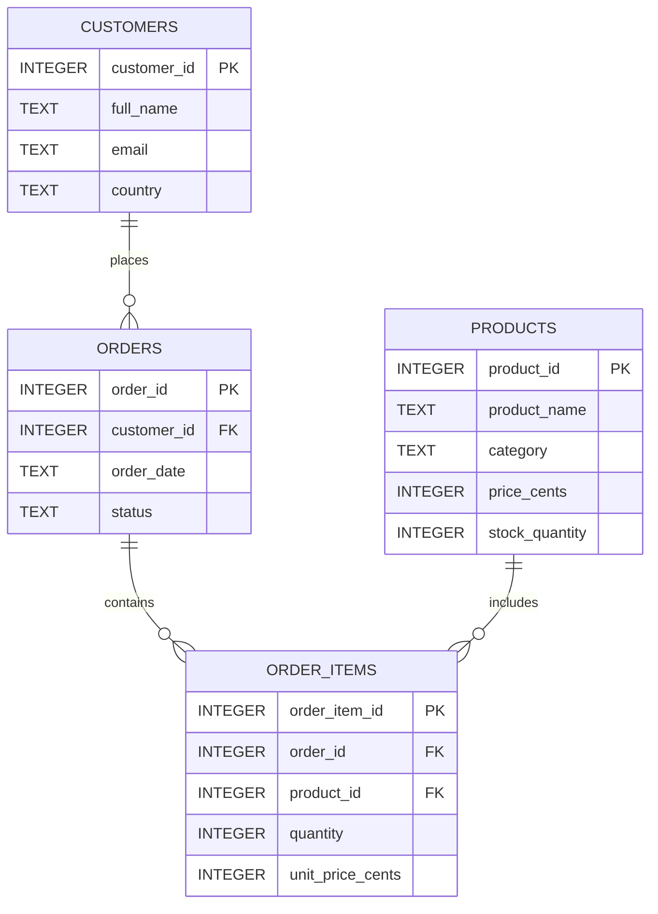
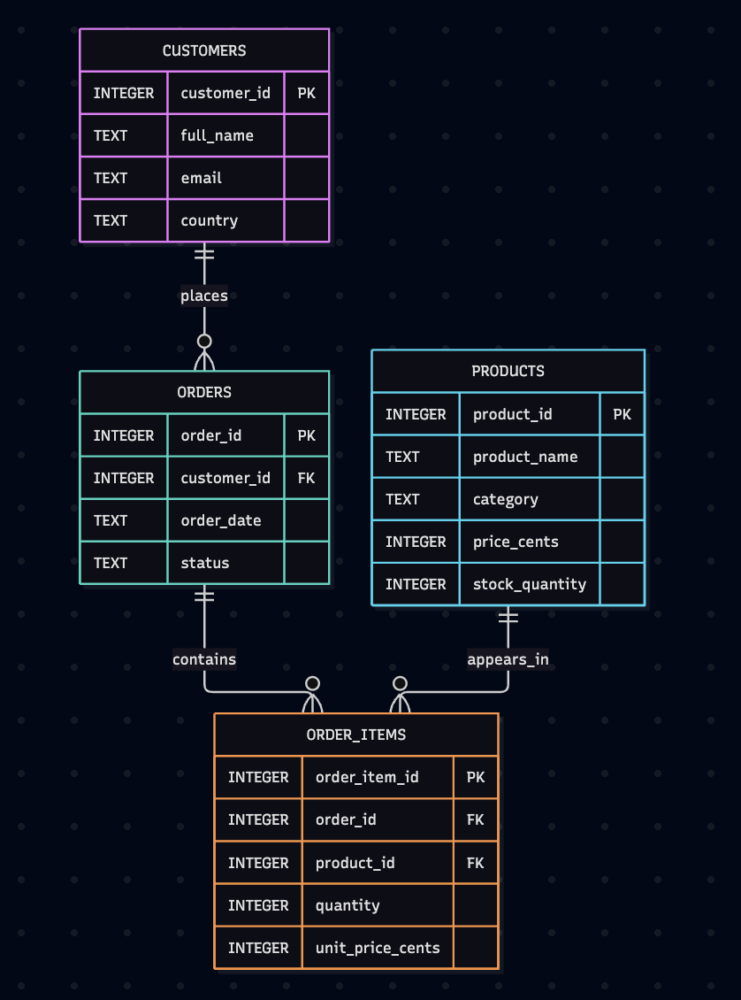

# RetailDB - SQL Order Management System

A relational database project designed to demonstrate
SQL development, database design and data analysis skills.

Built with SQLite.

## Project Overview

RetailDB simulates the database of a small online
electronics and accessories store.

The system manages customers, products, orders
and order details.

It demonstrates how relational databases can be
used to organize business information and generate
useful reports.

This is an independent portfolio project.
All customers and transactions are fictional.

## Technologies

- SQLite
- SQL
- Visual Studio Code
- Git
- GitHub

## Features

- Relational database with 4 tables
- Primary and foreign key constraints
- Referential integrity
- Data validation using CHECK constraints
- Sample customer and product records
- Order management data model
- SQL JOIN operations
- Aggregation and grouping
- Monthly sales reports
- Best-selling product analysis
- Customer spending analysis
- Inventory monitoring
- Database integrity checks

## Database Structure

The database consists of four tables:

1. customers
2. products
3. orders
4. order_items

### Entity Relationship Diagram


### Database Schema Preview



## Project Structure

```text
retaildb-sql/
|
|-- sql/
|   |-- 01_schema.sql
|   |-- 02_seed.sql
|   |-- 03_queries.sql
|   |-- 04_checks.sql
|
|-- data/
|
|-- screenshots/
|
|-- README.md
|-- .gitignore
```

## Getting Started

### Requirements

SQLite 3 command-line interface.

### 1. Clone the repository

```bash
git clone https://github.com/frachiaradia03/retaildb-sql.git
```

### 2. Enter the project directory

```bash
cd retaildb-sql
```

### 3. Create the database

```bash
sqlite3 data/retail.db < sql/01_schema.sql
```

### 4. Insert sample data

```bash
sqlite3 data/retail.db < sql/02_seed.sql
```

### 5. Execute the SQL queries

```bash
sqlite3 -header -column data/retail.db < sql/03_queries.sql
```

### 6. Run database checks

```bash
sqlite3 -header -column data/retail.db < sql/04_checks.sql
```

## SQL Queries

The project includes six business-oriented queries.

### Query 1 - Order Summary

Displays customer names, order dates,
order status and total order values.

### Query 2 - Monthly Revenue

Calculates monthly revenue from paid and
shipped orders.

### Query 3 - Best-Selling Products

Identifies the five most frequently sold
products and their generated revenue.

### Query 4 - Customer Spending

Ranks customers according to their
total completed-order spending.

### Query 5 - Low Stock Products

Identifies products with fewer than
15 units in stock.

### Query 6 - Order Details

Displays the products, quantities and
prices associated with a specific order.

## Sample Data

The demonstration database contains:

- 6 fictional customers
- 8 products
- 10 orders
- 18 order items

## Example Results

Monthly revenue calculated from the
sample data:

| Month | Orders | Revenue |
|-------|--------|---------|
| 2026-09 | 6 | EUR 622.07 |
| 2026-10 | 2 | EUR 306.40 |

Total sample revenue: EUR 928.47.

This is simulated revenue, not real sales.

## Data Integrity

The project includes:

- Primary key constraints
- Foreign key constraints
- Unique email addresses
- Positive quantity validation
- Non-negative price validation
- Referential integrity checks
- Database integrity verification

The database can be regenerated from the
SQL scripts included in this repository.

## Project Purpose

This project was created to demonstrate
practical SQL and relational database skills.

It is intended for learning, portfolio
presentation and technical demonstration.

No real customer information is used.

## Author

Francesco Chiaradia